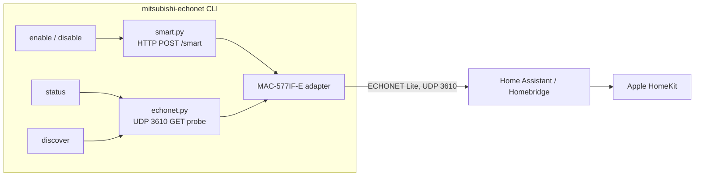

# Design: mitsubishi-echonet

## Problem

Mitsubishi Electric's MAC-577IF-E-class Wi-Fi adapters (MAC-577IF-E,
MAC-577IF2-E, MAC-587IF-E) contain a full ECHONET Lite server in firmware, but
outside Japan and AU/NZ it ships switched off and there is no official switch
in the MELCloud / MELCloud Home apps. Owners who want local, cloud-independent
control - or Apple HomeKit via a local bridge - have no official path.

## Goals

1. A one-command, read-only **status check**: is the adapter reachable, and is
   ECHONET Lite currently on or off?
2. A one-command **enable** and **disable** for ECHONET Lite.
3. Everything auditable: standard library only, no dependencies, every payload
   and protocol claim traceable to a public source.

Non-goals: a full ECHONET Lite controller (Home Assistant and Homebridge
plugins already do that well), MELCloud protocol work, or anything that writes
to the adapter beyond the documented enable/disable service commands.

## Architecture

- `smart.py` - the adapter runs an HTTP server on port 80. Every route except
  `/smart` (and `/license`) requires HTTP basic auth. `/smart` accepts an XML
  `<ESV>` document whose text is a base64 AES-128-CBC-encrypted `<CSV>` service
  command (IV prepended to the ciphertext). On all adapters analyzed publicly
  so far the key is the factory default: the literal string `unregistered`
  zero-padded to 16 bytes. The command `<CONNECT>ON</CONNECT><ECHONET>ON`
  enables ECHONET Lite; `<ECHONET>OFF` disables it. We ship both as fixed
  precomputed ciphertexts - no crypto code in this repo, and the enable
  ciphertext is byte-identical to the one the community has been using since
  August 2025. (A fixed IV is weak cryptography in general; here it matches
  how the published payload already works and the command carries no secrets.)
- `echonet.py` - minimal ECHONET Lite framing: build a GET request, send it by
  UDP to port 3610 (unicast for `status`, multicast 224.0.23.0 for `discover`),
  parse replies. A reply proves ECHONET Lite is enabled; silence plus a
  reachable port 80 means it is off; silence plus an unreachable port 80 means
  wrong IP or offline adapter.
- `cli.py` - thin argparse wrapper; all logic in the two modules above.

## Security model

- `/smart` needs **no credentials** - that is precisely why the community
  method works, and why it must only run on a trusted LAN.
- ECHONET Lite itself has **no authentication or encryption** (the official
  Mitsubishi NZ documentation says so too). Once enabled, any host that can
  send UDP to the adapter's port 3610 can control the AC.
- This repo contains no user data, no network details, and no secrets: the AES
  key is Mitsubishi's published factory default, not a personal credential.
- The adapter reports the ECHONET state change to MELCloud. That is inherent
  to the adapter, not something this tool causes or can prevent; the only way
  to stop it is firewalling the adapter off the internet (which also stops
  MELCloud Home).

## Known limitations

- Verified by the community on adapter application version 37.00 and newer;
  older versions untested.
- If an adapter's `/smart` key was changed from the factory default, our fixed
  payloads cannot work; melsmart (mafredri/meltools) supports custom keys.
- ECHONET Lite sets temperature in whole degrees Celsius only.
- A future Mitsubishi firmware update could disable ECHONET Lite again or
  change the endpoint. Updates arrive over the air via MELCloud. No breakage
  has been reported since the method was published (Aug 2025) as of this
  writing; the remedy would be to re-run `enable`.

## Alternatives considered

- **Home Assistant `echonetlite_homeassistant`** - the natural controller once
  ECHONET is on; we deliberately don't duplicate it.
- **Homebridge `homebridge-echonet-hvac`** - the direct Apple HomeKit path
  (HeaterCooler accessory), also ECHONET-based.
- **Direct `/smart` control (pymitsubishi/mac-577if-e)** - full local control
  over HTTP without ECHONET at all, using the same factory key. More moving
  parts and no ready-made HomeKit bridge, so we point to it rather than
  reimplement it.
- **ESP32 on the CN105 port (SwiCago/HeatPump)** - hardware modification;
  out of scope.

## Testing strategy

- Unit tests for framing (round-trip, malformed input), the `/smart` client
  (mocked HTTP), and the CLI (mocked network). 80% coverage floor in CI.
- Functional test against a real adapter is manual by design (needs the
  owner's network and consent): `status` before, `enable`, `status` after.

## Sources

- Enable method + fixed payload:
  <https://github.com/scottyphillips/echonetlite_homeassistant/issues/226>
- Protocol reverse-engineering (/smart, /service toggle, key storage, AES):
  <https://github.com/ncaunt/meldec/issues/2>
- Enable/disable commands and key handling:
  <https://github.com/mafredri/meltools> (`cmd/melsmart/main.go`)
- HA integration (UDP 3610, whole-degree note):
  <https://github.com/scottyphillips/echonetlite_homeassistant>
- Homebridge ECHONET HVAC plugin:
  <https://github.com/karlvr/homebridge-echonet-hvac>
- Official: ECHONET Lite on Mitsubishi interfaces (AU/NZ, incl. the
  no-security warning): <https://www.mitsubishi-electric.co.nz/wifi/learn_echonet.aspx>
- Official: MELCloud Home user manual (interface requires continuous internet;
  firmware updates):
  <https://media.crystallize.com/mitsubishi-prod_cb88776/25/11/28/1/melcloud-home-user-manual-v1-1-1.pdf>
- Direct-/smart alternative: <https://github.com/pymitsubishi/mac-577if-e>
